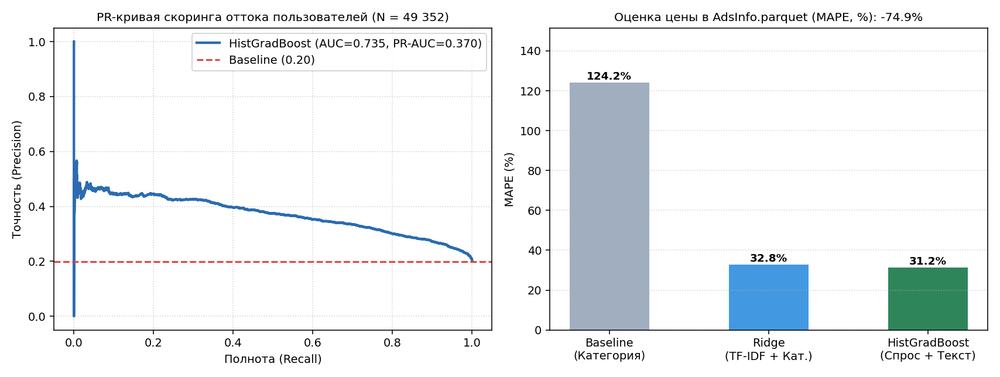

# Скоринг оттока пользователей и оценка цены объявлений (`rel-avito`)

Решение двух прикладных задач на данных *Avito Context Ad Clicks* (`rel-avito`): классификация оттока активных пользователей с калибровкой порога вероятности и регрессионная оценка рыночной стоимости объявлений по `AdsInfo`.



## 1. Скоринг оттока пользователей (N = 49 352)

* **Формирование выборки:**
  - Признаки считаются на 16-дневном историческом окне (`2015-04-25` — `2015-05-10`) по `VisitStream`, `SearchInfo`, `PhoneRequestsStream` и `UserInfo`: частота просмотров, поисков и контактов в окнах 1/3/7 дней, давность последней активности в часах, число уникальных карточек и категорий, доля авторизованных сессий и коэффициенты затухания активности.
  - Целевая метрика (`2015-05-11` — `2015-05-20`): полное прекращение просмотров карточек и запросов телефона (`Churn = 19.95%`).
  - Разбиение: `train` = 37 014 (5-Fold Stratified CV), `holdout test` = 12 338.

| Модель / Порог | CV `ROC-AUC` | Test `ROC-AUC` | Test `PR-AUC` | `Recall` | `F1` | Доля таргета | Чистый эффект (тест) |
| :--- | :---: | :---: | :---: | :---: | :---: | :---: | :---: |
| **`LogisticRegression`** | 0.7313 | 0.7317 | 0.3652 | — | — | — | — |
| **`HistGradientBoosting` (p₀ = 0.50)** | 0.7297 | 0.7351 | 0.3700 | 0.9% | 0.0183 | 0.4% | +333 руб. |
| **`HistGradientBoosting` (p* = 0.23)** | 0.7297 | **0.7351** | **0.3700** | **69.0%** | **0.4523** | **40.9%** | **+15 786 руб.** |

Из-за базовой доли целевого класса 19.95% стандартный порог `p₀ = 0.50` отсекает почти все наблюдения (`Recall = 0.9%`). Перенос порога в точку максимума `F1` (`p* = 0.23`) поднимает полноту охвата оттока до 69.0%.

## 2. Регрессия «Рыночная цена» (N = 60 000 объявлений)

* **Данные и признаки:**
  - Выборка: 60 000 объявлений из `AdsInfo.parquet` с валидной ценой `Price` (внутрикатегорийный диапазон IQR 25–75% для отделения основных товаров от аксессуаров, средняя цена — 25 400 руб., медиана — 11 000 руб.) и историей просмотров в `VisitStream` (≥ 3).
  - Признаки: `TfidfVectorizer` (30 000 биграмм заголовка `Title`) + `TruncatedSVD` (16 компонент) + линейный текстовый скор, дерево категорий `Category.parquet`, локации `Location.parquet` и метрики спроса (`views_cnt`, `contacts_cnt`).

| Модель | `MAPE` | `RMSE`, руб. | R² | ΔMAPE к бейзлайну | ΔRMSE к бейзлайну |
| :--- | :---: | :---: | :---: | :---: | :---: |
| **Baseline (медиана `ParentCategoryID`)** | 124.20% | 18 585 | — | — | — |
| **`Ridge` (TF-IDF + Категории)** | 32.77% | 10 133 | 0.8495 | -73.6% | -45.5% |
| **`HistGradientBoostingRegressor`** | **31.24%** | **9 356** | **0.8720** | **-74.9%** | **-49.7%** |

## Структура и запуск

* `project_3_ml_scoring.py` — сборка признаков, обучение моделей, подбор порога и оценка регрессии.
* `ml_scoring_metrics.json` — итоговые метрики.
* `ml_scoring_results.png` — PR-кривая классификатора и сравнение `MAPE` моделей регрессии.

```bash
pip install -r requirements.txt
python project_3_ml_scoring.py
```
